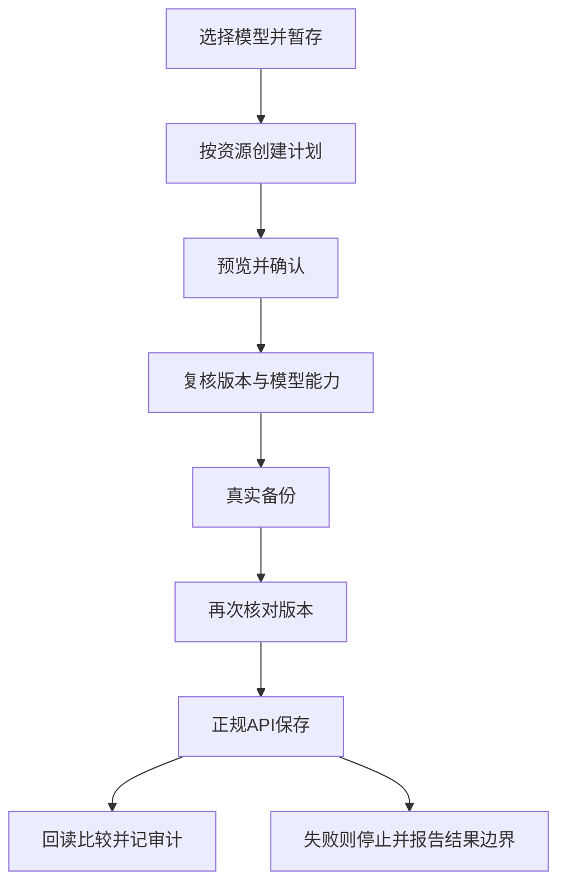

# AstrBot 模型切换器：设计与维护交接

更新日期：2026-10-29（香港时间，UTC+08:00）  
适用代码：`model-console/`，package version `0.1.0`。  
用途：供后续 Agent 接手现有实现，不是新建项目的建议稿。具体行为以当前源码、实际接口返回与测试为准。

## 1. 接手先读

按以下顺序工作：

1. 阅读本文的“身份与配置关系”“写入流程”“明确限制”。
2. 在项目目录运行 `node --test`，确认本次基线，不能复述旧记录的测试数。
3. 阅读 `src/registry.mjs`、`src/gateway.mjs`、`src/engine.mjs`；改 UI 再读 `public/app.mjs`、`public/ui-state.mjs`。
4. 如需确认运行态，先只读请求控制台 `/health`、`/snapshot`；必要时运行 `node src/inspect.mjs`。不要把只读检查变成自动保存或生成测试。
5. 记录目标、改前状态、变更范围、验证证据和未验证内容。不要自动重放历史运维脚本。
6. 若目标是“远程多设备”或“打包给其他用户”，先读 2026-10-29 的[缺陷评审](REVIEW-2026-10-29.zh-CN.md)与[改造设计](DESIGN-multi-device-2026-10-29.zh-CN.md)；本文描述的是当前单机实现，不代表远程能力已存在。
7. 下一轮任务从 [P1/P2 待修复清单](BACKLOG-2026-10-29.zh-CN.md) 取，按优先级与验收标准推进；完成一项就更新清单和工作记录。

本项目此前对 bot 身份的错误已纠正。旧工作记录中的“示例旧名称官方 bot”“示例机器人B是 QQ 昵称”等判断不能直接沿用。工作区旧 AGENTS.md 的约束已被用户在会话中明确撤销，不能把文件仍然存在视为重新授权；仍应遵守当前会话和实际执行环境的权限。

## 2. 用户目标与实现边界

用户需要一个独立、本机运行、有 UI 的模型控制台，集中查看并更换 AstrBot 核心、各 bot 对应配置和插件使用的模型。页面采用总览与卡片结合的方案：

- 顶部：配置摘要、连接状态、最近同步、只读或编辑模式。
- 左侧：总览、本体、插件模型、模型库的锚点导航；`aria-current=location` 表示当前选中，不能再用 CSS first-child 固定高亮。
- 本体区：先显示实际机器人实例卡片，再显示共享 default 配置；未使用配置档案单独折叠。
- 插件区：每插件一张卡片，展开后显示任务用途、模型选择和配置状态。
- 模型库：共享模型定义、已登记引用与推理强度。
- 右侧：未提交的修改；预览后再次确认，再按资源顺序应用。

技术取舍：Node.js 24.22+，ESM + JSDoc，原生浏览器 JavaScript/CSS，无 Python、无第三方运行依赖、无前端构建步骤。JSON 后端和界面分开，避免把业务规则分散到 DOM 事件里。

首版是配置管理工具，不是模型网关、QQ 协议端或在线状态监测器。它不代理模型生成，不新增提供商，不编辑凭证，不自动重建向量索引。

## 3. 身份与配置关系：必须正确

### 3.1 四种对象不能混为一谈

| 对象 | 真源 | 含义 |
|---|---|---|
| 机器人实例 | AstrBot `GET /api/v1/bots`、`/bots/stats` | 实际配置的平台 id/type，以及适配器运行状态 |
| 配置档案 profile | `/config-profiles`、具体 profile config | 主模型、压缩、视觉等配置；profile 名称不是机器人身份 |
| 人格 persona | AstrBot 人格 API/数据库 | 人设内容；不能因名称像 bot 就当作平台实例 |
| 模型定义 provider | 全局 `provider` / `provider_sources` | 模型名、连接来源、能力声明、共享请求参数 |

已核实：AstrBot provider manager 注册模型时使用全局模型列表。profile 中的 provider/provider_sources 旧副本不能当作独立运行时注册表。此前同步副本仅修复当时的旧快照，不代表以后永不陈旧。

### 3.2 default 是合法的机器人配置目标

机器人实例不必有专用 profile。使用 default 的机器人仍必须独立显示，并把修改保存到 default。

本次接手基线（只是已观察实例，不可硬编码到业务逻辑）：

| 实例标识 | 实际类型 | 配置目标 | 展示要求 |
|---|---|---|---|
| 示例机器人A | `qq_official` | `default` | 独立 QQ 机器人卡片，明确“使用全局默认配置” |
| onebot | `aiocqhttp` | `<profile-UUID>` | OneBot 卡片，来源是实例与明确路由 |
| `<unused-profile-UUID>` | 不是独立 bot 的证据 | 未发现关联实例 | 仅作为未使用配置档案；不能拿来代替示例机器人A |

历史 profile 显示名“示例旧名称”不构成任何已使用机器人身份的证据。实际 `type` 拼写是 `qq_official`，不是 `qq_offical`。

### 3.3 名称证据规则

- `src/identity.mjs` 只从 AstrBot 实例 id/type 和路由生成白名单元数据。
- AstrBot 实例标识可作为卡片标题，但必须标明来源，不能声称它就是 QQ 在线昵称。
- 不从 profile.name、persona 名称或本地 `onebot_<uin>.json` 文件名推断在线账号、昵称或 bot 类型。
- 没有可靠昵称时保持 `nickname=null`；没有可靠账号时保持 `account=null`。
- `/bots/stats` 的 running 只代表适配器状态，不证明 QQ 收发链路或模型可用。
- 身份元数据查询失败时不“猜一个”；应留空或标为未核实。

当前路由解析只覆盖 `platform_id::` 精确平台级路由及 default 回退；不完整模拟 AstrBot 的会话级/通配符路由。存在细粒度路由时，不得把卡片解析称为任意会话最终配置。

### 3.4 展示视图不能改变保存资源

`public/ui-state.mjs → profileViews()` 把配置资源转成机器人视图。同一 default 可以同时出现在 bot 卡片和共享配置卡片中：

- 卡片 key 使用 bot id，供展开状态区分。
- 草稿和保存 key 始终使用原 `resource.kind/id + path`。
- 从两个入口编辑同一字段，只产生一份资源修改计划。
- 未使用 profile 放进“未使用的配置档案”分组，不冒充在线账号。

## 4. 目录与模块职责

| 路径 | 职责 | 修改时注意 |
|---|---|---|
| `src/registry.mjs` | 已审查字段、能力、空值语义与额外字段发现 | 发现不等于授权修改；不能靠名字含 model 就开放写入 |
| `src/gateway.mjs` | 动态端口、JWT、AstrBot API、资源与实例元数据、能力目录 | 只在后端处理密钥；核实真实 API shape |
| `src/identity.mjs` | 实例/路由到公开身份 | 不加入 profile 名称、QQ 文件名等推断 |
| `src/engine.mjs` | snapshot、revision、校验、计划、备份后保存和回读 | 单资源；失败可能已经写入 |
| `src/backup.mjs` | 文件备份、SHA-256、SQLite 在线备份、quick_check | 备份失败必须阻断写入 |
| `src/server.mjs` | HTTP、鉴权、静态白名单、CSP、请求体限制、备份/恢复/设备路由 | 不暴露源码、state 或备份 |
| `src/diagnostics.mjs` | 诊断日志（1 MiB 滚动、保留 3 份、脱敏、失败静默） | 不得记录 token/key/请求体/绝对路径 |
| `src/devices.mjs` | 远程设备注册表 + 密钥分离存储（devices.json / secrets.json） | 响应/日志/诊断不得出现 apiKey；读写 state 用临时文件+rename |
| `src/http-adapter.mjs` | 远程 AstrBot OpenAPI v1 适配器（Bearer API Key） | 只走 `/api/v1/`；错误映射 DEVICE_*；远程只读 |
| `src/ssh-tunnel.mjs` | SSH 设备隧道：`-N -L`、远端日志端口发现、就绪轮询、幂等 close | 只传参数数组不拼 shell；错误映射 DEVICE_SSH_*/DEVICE_PORT_UNKNOWN |
| `src/agent.mjs` | Agent 进程：127.0.0.1、一次性配对码、token 哈希存储、`/agent/v1/health|pair|snapshot` | 不存明文 token；配对码一次性+限频；默认只读 |
| `src/agent-adapter.mjs` | Hub 侧 Agent 配对/快照/plan/apply/backups 适配器 | 不记录/回传 token；错误映射 AGENT_* |
| `src/secure-store.mjs` | Windows DPAPI 加解密（值只走 stdin/stdout），失败 `SECURE_STORE_UNAVAILABLE` | 值/密文不得进命令行参数；非 Windows 明确降级 |
| `src/inspect.mjs` | 只读实际实例快照 | 不引入隐藏写操作或生成调用 |
| `scripts/build-package.mjs` | 便携包/zip 生成、SHA256SUMS（无安装器/自动更新） | 只按白名单复制，排除 state/.git/.tmp/日志/测试 |
| `public/index.html` / `styles.css` | UI 结构与视觉样式 | 选中态、响应式、焦点和错误状态 |
| `public/app.mjs` | DOM、刷新、草稿、预览、顺序保存 | 使用 textContent；不能插入配置为 HTML |
| `public/ui-state.mjs` | 可测试的草稿、分组、候选模型、身份卡片、冲突 diff、设备选择、token 持久化 | 维持 bot view 与 profile resource 的区别 |
| `test/*.test.mjs` | 纯逻辑、HTTP、安全、备份/恢复、设备/适配器、a11y 和身份回归 | 写入使用 fake gateway，不动线上配置 |
| `start-console-edit.cmd` | 唯一启动入口：启用保存并打开浏览器（编辑模式） | 保存仍需预览与用户确认；无独立只读脚本，临时只读用 `node src/server.mjs --open` |
| 状态目录（默认 `%LOCALAPPDATA%\AstrBotModelConsole\state`） | 备份、审计、诊断、设备、密钥、锁 | 含敏感数据，不能分享或提交 |

`.gitignore` 排除 state/、node_modules/ 和 *.log。它不是文件访问保护；仍不能把项目根目录直接映射为静态目录。

## 5. 字段覆盖表

当前核心每个 profile 登记 6 类绑定：

| 字段 | 能力 |
|---|---|
| `agent_runner.config.model.provider_id` | llm |
| `agent_runner.config.compression.provider_id` | llm |
| `provider_settings.default_image_caption_provider_id` | vision |
| `provider_stt_settings.provider_id` | stt |
| `provider_tts_settings.provider_id` | tts |
| `provider_ltm_settings.image_caption_provider_id` | vision |

插件登记 15 个字段：

| 插件 | 路径 | 能力/语义 |
|---|---|---|
| group_chat_plus | `decision_ai_provider_id` | llm；空值按会话选择 |
| group_chat_plus | `image_to_text_provider_id` | vision |
| group_chat_plus | `private_image_to_text_provider_id` | vision；空值未核实 |
| livingmemory | `provider_settings.embedding_provider_id` | embedding |
| livingmemory | `provider_settings.llm_provider_id` | llm |
| livingmemory | `recall_engine.rerank_provider_id` | rerank |
| self_learning | `Model_Configuration.filter_provider_id` | llm |
| self_learning | `Model_Configuration.refine_provider_id` | llm |
| self_learning | `Model_Configuration.reinforce_provider_id` | llm |
| self_learning | `V2_Architecture_Settings.embedding_provider_id` | embedding |
| self_learning | `V2_Architecture_Settings.rerank_provider_id` | rerank |
| meme_manager | `semantic.vision_provider_id` | vision |
| meme_manager | `semantic.embedding_provider_id` | embedding |
| meme_manager | `auto_collect.vision_provider_id` | vision |
| meme_manager | `generation.emotion.llm.provider_id` | llm |

只允许更改共享 provider 的 `custom_extra_body.reasoning_effort`。当前支持级别通过本机反代 `/models?client_version=0.161.0` 查询，未知能力拒绝，不把客户端版本视为永远有效的常量。Luna 此前目录支持到 max，不支持 ultra；当前用户选的强度是可变配置，不能按旧记忆强制恢复 max。

`discover()` 仅递归扫描对象中的字符串 provider_id/model_id 后缀，跳过数组，也不能覆盖 schema 未落盘默认值、硬编码及动态模型调用。现有“33 个绑定”是已登记范围，并不等于全系统所有调用点。

## 6. 数据读取与性能

1. 从 AstrBot 日志最新 `Starting WebUI at` 取得管理端口。不能写死历史端口。
2. 日志按 64 KiB 块逆读，首次查找可能遍历较长文件；后续根据长度和 mtime 缓存、增量找新启动行。
3. 主配置按 UTF-8 读取并去除 BOM，JWT HS256 在后端内存构造。
4. 全局 provider/source 生成模型清单；类型和 modalities 生成能力声明。声明不等于实际多模态调用已成功。
5. 读取 profile、插件配置、实例及路由，生成白名单 snapshot；单资源失败标 unavailable。
6. snapshot TTL 2 秒，同时进入的读取共享 pending promise。UI 前台每 3 秒刷新，隐藏标签暂停，恢复可见时再次刷新。

当前 resource 读取是顺序执行，元数据请求也未独立缓存。扩展插件多时，可做有上限的并发和更长的元数据缓存；不要无上限 Promise.all 或增加高频全量数据库扫描。

UI 刷新不能覆盖草稿；编辑控件聚焦或预览弹窗打开时避免重建界面。只读刷新不创建备份或审计。模型强度能力按用户展开时查询，不逐模型每轮探测。未知空值保留原样，不自动填 0 或某个默认模型。

## 7. 配置写入流程



具体约束：

- 每个计划只修改一个 profile、plugin 或 provider，保留完整原配置的其他字段。
- revision 为规范化对象的 SHA-256，不包含明文配置在公开返回里。
- 前端发送 expectedRevision；后端计划创建、应用前、备份后分别核对版本，应用时还重新检查模型启用状态和能力。
- 单个 Engine 通过 busy 锁串行写入；它不能协调多个独立进程。
- 每个计划最多 30 项修改，最多 100 个待处理计划，10 分钟过期；计划仅在内存中，重启失效。
- API 写入后回读与预期完整对象比较；不直接 fs 覆盖 AstrBot 在线配置。
- UI 多资源按顺序应用，失败即停止；已完成资源不假装回滚，未完成草稿继续保留。
- `saved-and-readback-verified` 只证明保存与回读。generationVerified / hotLoadVerified 仍是 false，工具没有独立生成或日志验证器。
- 写请求发出后若断线或回读失败，返回 `outcome=possibly-written`、计划和备份索引，失效缓存；必须先核对，不自动重复提交。

AstrBot 没有原子 CAS。最后一次版本检查与 PUT 之间仍有外部客户端修改的窗口；双重检查不等于原子事务。跨资源保存也不是原子操作。

## 8. 两层 API 契约

### 控制台本机 API

除静态白名单外均需本次工具会话 Bearer token；Host/Origin 也要匹配本机地址。

| 方法/路径 | 作用 |
|---|---|
| GET `/health` | `{status,version,dataPath,stateDir,readOnly,startedAt}`；不表示 AstrBot/QQ 在线 |
| GET `/snapshot[?device=]` | 白名单模型、revision、绑定、身份、routing、device；远程设备只读 |
| GET `/capabilities?provider_id=...` | `{levels,verified}`，未知不编造档位 |
| POST `/plans` | `{resource,changes,expectedRevision}`，产生计划不等于应用 |
| POST `/apply` | `{id}`，只在启动显式允许写入时执行 |
| GET `/backups` | 备份列表 + `stats{count,bytes}` + `limits{keep,maxBytes}` |
| POST `/backups/prune` | `{keep}`，清理旧备份（保留最新，不需 `--enable-writes`） |
| GET `/backups/:id/diff?kind=&id=` | 恢复前已审查字段差异（只读，不建计划） |
| POST `/restore-plans` | `{backupId,resource,expectedRevision}` → 恢复计划（整对象回写） |
| GET `/devices` / POST `/devices` / DELETE `/devices/:id` | 远程设备注册表；响应不含 apiKey |
| GET `/devices/:id/health` | 远程可达性与延迟 |
| GET `/diagnostics/export` | 诊断事件导出（脱敏） |

POST 为 application/json，上限 64 KiB。示例仅表示请求结构：

```json
{
  "resource": {"kind":"profile","id":"default"},
  "changes":[{"path":"agent_runner.config.model.provider_id","value":"已有且已启用的模型ID"}],
  "expectedRevision":"从最新snapshot取得的revision"
}
```

### AstrBot 管理 API

| 资源 | GET | 保存 |
|---|---|---|
| provider | `/api/v1/providers/by-id?provider_id=...` | PUT同路径，body `{provider_id,config:完整对象}` |
| profile | `/api/v1/config-profiles/{id}` | PUT同路径，body为完整config本身；不是外包config字段 |
| plugin | `/api/v1/plugins/config?plugin_id=...` | PUT `/api/v1/plugins/config`，body `{plugin_id,config:完整对象}` |
| profile列表 | `/api/v1/config-profiles` | 本工具不创建或删除 |
| 实例 | `/api/v1/bots`、`/api/v1/bots/stats` | 本工具只读 |
| 路由 | `/api/v1/config-routes` | 本工具只读 |

AstrBot 返回体由 gateway 去掉data外层，并适配 provider/config/info_list 等具体结构。升级时先读本机 dashboard API/service 源码，不猜请求体。

## 9. 备份、审计与恢复

每次应用前：

- 复制 cmd_config.json 及 data/config 下全部 JSON（包括 profile 和插件配置），逐项 SHA-256/字节核对。
- 通过 node:sqlite.backup 备份 data_v4.db；对产物执行 PRAGMA quick_check。
- 备份位于 MODEL_CONSOLE_STATE/backups/<uuid>/；manifest.json记录文件哈希和SQLite校验结果。
- 任一步失败则不发出写请求。

审计为状态目录下的 `audit.jsonl`（默认 `%LOCALAPPDATA%\AstrBotModelConsole\state\audit.jsonl`），包含 apply-start/applied/apply-failed、资源、时间和备份路径；不保存完整配置或凭证。applied表示当时回读成功，不能替代对当前值的复核。不同快照之间不是跨文件原子备份，外部并发写入仍需注意。

每份备份都有 `manifest.json`；`GET /backups` 返回列表/占用，`POST /backups/prune` 清理。恢复入口：`GET /backups/:id/diff` 看已审查字段差异 → `POST /restore-plans` 生成计划 → 预览 → `/apply`。**恢复是整对象回写**（备份中的配置整体覆盖目标资源），只有列出的已审查字段差异经过校验；apply 仍做 revision 双检、写前备份和读回验证。

没有自动回滚；恢复前先看差异。索引、数据库或全局灾难恢复要单独规划，不能把旧 SQLite 文件直接覆盖运行中库。插件自己的数据库（例如 self_learning messages.db）、图片和向量索引不在本工具备份范围内；普通绑定修改不代表已备份所有插件数据。

## 10. 启动与部署

源码目录：`model-console`。

本机 AstrBot DATA（当前部署位置，仅作为示例；启动时按优先级自动发现，见下表）：

`C:\Users\<你>\.astrbot_launcher\instances\<实例ID>\core\data`

```powershell
cd 'model-console'
node --version
node --test --test-isolation=none   # 受限沙箱里 node --test 会因 spawn EPERM 失败；正常环境可省参数
# 唯一启动入口（编辑模式；保存仍需预览+确认）：
.\start-console-edit.cmd
# 临时只读查看（不推荐日常用）：
node src/server.mjs --open
# 远程 Agent（可选；给 Hub 配对用，只读）：
node src/agent.mjs --port=0 --state=<state目录>
# 便携包：
node scripts/build-package.mjs [--zip]
```

| 变量/参数 | 作用 |
|---|---|
| ASTRBOT_DATA | 可选；优先使用。未设置时扫描 `%USERPROFILE%\.astrbot_launcher\instances\*\core\data` 与 `%USERPROFILE%\.astrbot\data`，唯一命中才自动使用，多个/零个报 `ASTRBOT_DATA_REQUIRED`。两个 cmd 脚本不再写死路径。 |
| MODEL_CONSOLE_STATE | 备份/审计/锁目录；默认 `%LOCALAPPDATA%\AstrBotModelConsole\state`，无 LOCALAPPDATA 时用系统临时目录。项目内旧 `state/` 只提示、不迁移。 |
| MODEL_CONSOLE_PORT | 默认0，操作系统分配随机回环端口 |
| MODEL_CONSOLE_SESSION_TOKEN | 可选、64位小写hex；仅受控重启保留现有工具会话使用，普通启动不设置 |
| MODEL_CONSOLE_BACKUP_KEEP | 备份保留份数，默认10；只清理含 manifest.json 的 UUID 目录，绝不动最新一份 |
| MODEL_CONSOLE_BACKUP_MAX_MB | 备份总大小上限（MB），默认 2048；超限删最旧，告警写诊断 |
| `--enable-writes` | 显式允许应用，不会自动保存 |
| `node src/agent.mjs --enable-writes` | 远程 Agent 允许 Hub 计划/应用/备份；不加则只读 |
| `--open` | Windows打开带本次工具令牌的浏览器地址 |

单实例：启动时在状态目录写 `instance.lock`（pid/监听端口/启动时间）。已有存活实例时第二个进程打印 `ANOTHER_INSTANCE_RUNNING`、pid/端口并以退出码 1 结束；进程崩溃留下的锁会在下次启动时按“pid 不存活”自动清理。SIGINT/SIGTERM 会释放锁并关闭服务。

当前曾使用56520端口；端口和PID都是运行记录，不是永久配置。自定义后台启动会写 state/active-service.json，索引stdout/stderr与PID；普通cmd启动没有更新该索引的逻辑，因此它可能过期，不能不核实就杀其中PID。

工具令牌存 `sessionStorage`：同标签刷新会恢复，关闭标签失效；URL hash 读取后立即清除。首次启动输出里的带 token URL 仍不要分享。重启进程会丢失所有内存计划。

只改public静态文件通常刷新即可；改后端模块要重启本工具。先告知可能有未提交草稿；只停止已核实属于本控制台的进程，不批量结束node.exe，不重启AstrBot。

控制台不会启动 AstrBot。若AstrBot管理接口不通，界面应显示断线并保留草稿，实例恢复后自动重连；不要以此为由离线改配置或绕过鉴权。工具支持编辑的范围不等于被授权自动修改所有线上内容。

## 11. 安全边界

- 仅监听127.0.0.1；不改0.0.0.0、不新增公网映射。
- 静态资产白名单只有页面、样式和前端模块；不开放src/state/任意路径。
- Host/Origin、跨站请求标记与随机会话token共同校验；CSP限制同源脚本/连接，禁止内联脚本。
- AstrBot JWT和上游API key只在后端使用；只读公开snapshot也不能回传原配置。
- 配置渲染使用textContent，不用innerHTML拼接。错误只展示安全错误码，不输出服务端原始正文、密钥或聊天记录。
- `state/`（默认已迁到 `%LOCALAPPDATA%\AstrBotModelConsole\state`）中的备份含凭证；只打包源码、测试与文档，排除 state、.tmp运维备份和日志。项目内旧 `state/` 仍在时不自动打包、不自动迁移。
- 公共机器人实例标识不等于QQ账号/昵称。新增元数据先确认语义与来源，再选字段白名单。

## 12. 测试与证据分级

接手运行 `node --test --test-isolation=none`（受限沙箱里 `node --test` 会因 spawn EPERM 失败；正常环境可省略参数）。2026-10-29 第二阶段审计后基线是 **290 项（288 pass / 2 skip，0 fail）**（以当次结果为准）。

| 测试文件 | 重点 |
|---|---|
| backup.test.mjs | SQLite 备份、保留份数、总大小上限、onWarning、备份列表/读取 |
| engine.test.mjs | 冲突、禁写、能力、空值索引拦截、backupId 脱路径、field-missing、恢复计划、routing |
| server-ui.test.mjs | 静态白名单、鉴权、CSP、409 details、/health、/backups、/restore-plans、诊断接线 |
| server-devices.test.mjs | /devices CRUD、去密钥、health、远程快照缓存隔离、错误映射 |
| gateway.test.mjs | 端口/配置缓存、并发去重、routingSummary |
| diagnostics.test.mjs | 白名单、脱敏、滚动、并发有序 |
| devices.test.mjs / http-adapter.test.mjs | 设备注册表密钥分离、OpenAPI Key 适配器与错误码 |
| ssh-tunnel.test.mjs | SSH argv/端口发现/就绪/超时/ENOENT/close 幂等 |
| agent.test.mjs / agent-adapter.test.mjs | Agent 配对/限频/过期/token 哈希/快照鉴权；Hub 侧适配器错误映射 |
| ui.test.mjs | 草稿、分组、冲突 diff、token、设备选择器（HTTP/SSH/Agent）/恢复契约 |
| a11y.test.mjs | 字号、对比度、可访问名、skip link、设备表单、诊断导出 |
| config.test.mjs / lock.test.mjs | state 优先级、数据发现、单实例锁 |
| p0-integration.test.mjs / sprint-integration.test.mjs / epic2-integration.test.mjs | P0、Sprint、Epic-2/3 的跨模块集成回归 |

现有自动测试不是真实浏览器视觉或端到端点击测试。当前工具环境无浏览器自动化入口时必须说明，不能把DOM逻辑测试说成屏幕验收。

**冒烟脚本纪律**：启动/接口冒烟只用 `node`（`.mjs`、临时文件或一次性命令），不要在工作区生成 `.ps1`。本机杀软曾把 `model-console/p0-smoke.ps1` 判为木马并隔离——该脚本只做“临时 state 启动 server → 读 stdout 的 token → 请求 127.0.0.1/health → Stop-Process”，但 `Start-Process -WindowStyle Hidden` + token 正则 + `Stop-Process -Force` 的组合会触发 PowerShell 木马启发式。它是无害测试脚本，不是项目代码；`.gitignore` 已排除 `*.ps1`。若杀软仍显示隔离项，在保护历史里选择“删除/移除”，不要“还原”。

证据须分层报告：源码可行 → mock测试 → 真实只读接口 → API/磁盘回读 → 独立热加载日志 → 实际模型调用。不要跳级。本工具正常使用不会主动进行最后两层验证。

## 13. 常见故障定位

| 现象/错误码 | 检查顺序 |
|---|---|
| ACCESS_DENIED | 本次token、是否换端口/进程、Host/Origin；不要关闭鉴权。前端会在收到该错误时清掉 sessionStorage token 并回连接表单 |
| CONSOLE_UNREACHABLE | 本工具进程与端口，再查启动stderr；不等于AstrBot已停 |
| ASTRBOT_DATA_REQUIRED | 未设置 ASTRBOT_DATA 且自动发现到 0 个或多个 data 目录；按提示用环境变量指定，不要猜 |
| ANOTHER_INSTANCE_RUNNING | 同一状态目录已有存活实例；复用其窗口或先关闭旧实例。锁文件在状态目录 `instance.lock`，pid 不存活时下次启动会自动清理 |
| ASTRBOT_UNREACHABLE | 实例是否启动、最新启动日志、管理端口；不是QQ端口 |
| REQUEST_TIMEOUT | 若在保存中，先回读确认结果；不要直接重复提交 |
| CONCURRENT_CHANGE | 外部修改或草稿基线过期，核对差异后重新编辑 |
| EFFORT_UNVERIFIED_OR_UNSUPPORTED | 本机反代模型目录是否可读、档位是否支持；不按名字猜 |
| VERIFY_FAILED / possibly-written | 查audit和备份，读取当前配置，确认已完成范围，再制定恢复 |
| bot被显示为未关联profile | 先读bots与routes，再查identity/profileViews；default必须是合法目标 |
| 账号名称像人格/旧profile名 | 删除推断，核查实例id/type与昵称字段真实语义 |
| 执行命令在创建前报sandbox provisioning失败 | 属于执行环境故障，不证明项目或目录不存在；勿假称用户未授权 |

## 14. 待改进项与当前缺口

1. 完整的会话级/通配符路由解析；目前仅平台级视图，UI 在 `granular>0` 时提示。
2. 插件schema/API驱动发现与适配器，覆盖数组、隐藏默认值与动态调用；未审查字段始终只读。
3. ~~向量/重排模型独立迁移流程。~~ **2026-10-29 P0 已修**：空值同样抛 `INDEX_MIGRATION_REQUIRES_SEPARATE_WORKFLOW`；独立迁移流程本身仍未实现。
4. **恢复已做**（备份列表/diff/恢复计划，整对象回写）；仍需防止覆盖备份之后其他人的修改——当前靠 revision 双检缩小窗口，不是原子事务。
5. 受控日志/运行时验证器，明确“已热加载”与“已调用”证据，而不是仅改成功提示。
6. ~~控制台单实例管理和启动器改进。~~ **P0 已部分修**：单实例锁与令牌刷新存活已完成；`active-service.json` 索引过期、启动器仍待改进。
7. ~~更完整的错误诊断与只读操作日志。~~ **Sprint A 已做**：`diagnostics.jsonl` 脱敏滚动；未做限流与只读操作全量审计。
8. ~~有上限的资源并发读取和身份元数据缓存。~~ **Sprint A 已做**：gateway 缓存 + 并发去重；身份元数据仍是顺序读取。
7. ~~更完整的错误诊断与只读操作日志。~~ **Sprint A 已做**：`diagnostics.jsonl` 脱敏滚动 + 120/min 限频 + UI 导出；未做只读操作全量审计。
8. ~~有上限的资源并发读取和身份元数据缓存。~~ **Sprint A 已做**：gateway 缓存 + 并发去重；身份元数据仍是顺序读取。
9. UI 端到端、键盘和响应式视觉验收仍未做；当前只有静态 a11y + DOM 契约测试。真实浏览器在本沙箱因 Chromium 命名管道 IPC 被拒，需在沙箱外补。
10. 远程设备（HTTP/SSH/Agent）目前只读：`/plans`、`/apply` 未按 device 路由；Agent 本地备份索引、热加载日志验证未做。
11. 便携包与 zip 已可构建并验证 SHA；无安装器/自动更新（Epic-3 只做便携 node）。未在无 Node 的干净 Windows 上独立启动验证。
12. ~~RISK-11：设备 API Key 明文存 `secrets.json`~~ **已修**：Windows DPAPI 加密 `dpapi:`，启动时自动迁移旧明文；DPAPI 不可用时降级明文并在诊断留痕（Hub UI 暂不提示）。真实 SSH/第二台 Windows、干净 Windows 启动、真实 Ctrl+C、DPAPI 多用户/域环境仍未验证。
13. 远程写仅限 Agent（目标机本地备份/审计 + hotLoad 证据）；HTTP/SSH 只读。`hotLoad.marker` 在 Agent 侧未先脱敏，由 Hub 脱敏；只读 Agent 的 `/agent/v1/backups` 可列备份。
14. 真实浏览器已用 Chrome headless 验收（`docs/assets/e2e-home-2026-10-29.png`）；键盘/屏幕阅读器仍缺。

## 15. 修改后的交付要求

说明改了哪些文件、为何修改、测试结果、实际部署是否更新、是否改线上配置及验证边界。涉及模型和路由时列出旧值/新值与证据，不使用之前对话里的“当前模型”作为恒定事实。

新增插件支持至少修改registry与相关UI标签，核对真实配置/API、空值语义、能力类型与共享范围，并补“非目标字段保留、能力拒绝、并发冲突”测试。新增bot适配优先扩展identity/profileViews，不把persona/profile名字补进bot映射表。

相关工作记录位于上级 `docs/history/`，重点参考：

- `2026-10-29-模型控制台底层实现.md`
- `2026-10-29-模型控制台UI接入.md`
- `2026-10-29-控制台错误提示排查.md`
- `2026-10-29-机器人身份来源纠正.md`
- `2026-10-29-default机器人卡片纠正.md`
- `2026-10-29-模型控制台评审与多设备设计.md`
- `2026-10-29-模型控制台P0修复.md`
- `2026-10-29-模型控制台SprintABC.md`
- `2026-10-29-模型控制台Epic2.md`
- `2026-10-29-模型控制台Phase3.md`

历史记录是证据线索，不是当前状态真源。遇到与本文或源码不一致的旧结论，以现场接口和源码核实后更新文档。
