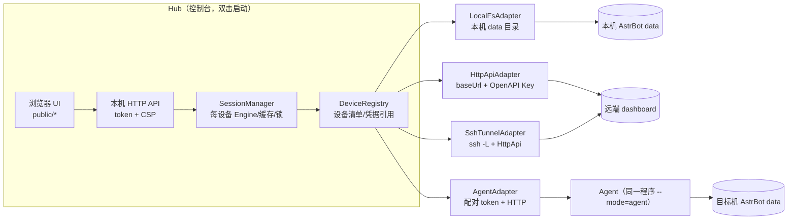

# 模型切换器：多设备获取与可分发改造设计

日期：2026-10-29（UTC+08:00）  
状态：**设计提案，未实施**。配套评审见 [`REVIEW-2026-10-29.zh-CN.md`](REVIEW-2026-10-29.zh-CN.md)。  
目标读者：接手 `model-console/` 的下一位实现者。

## 0. 一句话方案

把“本机模型控制台”升级为 **“一个控制台（Hub）+ 多种设备连接（Device Adapter）+ 同一程序兼作设备代理（Agent）”** 的 Windows 桌面工具；近期用 **AstrBot 官方 OpenAPI Key** 解决远程认证，用 **便携 Node 运行时 + per-user 安装器** 解决分发，单 exe（SEA）与 Electron 暂不采用。

## 1. 目标与非目标

### 目标

1. 一个窗口里切换多台 Windows 设备上的 AstrBot，查看并修改核心/插件模型绑定与推理强度。
2. 设备连接方式可插拔：本机文件系统、远端 dashboard HTTP、SSH 隧道、自建 Agent。
3. 可分发给不懂 Node 的 AstrBot 用户：双击安装、首次向导、自动发现本机实例、更新提示、卸载保留数据。
4. 安全边界可解释：每台设备独立凭据、可撤销、最小权限、审计能回答“谁在哪台机器改了什么”。

### 非目标（明确不做，避免和 launcher 抢位置）

- 不启动/停止/升级 AstrBot 实例（launcher 的职责）。
- 不代理模型生成、不编辑 provider 凭证、不重建向量索引。
- 不做跨设备原子事务；不承诺“保存=热加载”。
- 不做云端同步/多租户 SaaS；数据默认只在本机。

## 2. 用户与场景

| 场景 | 用户 | 关键诉求 | 对应能力 |
|---|---|---|---|
| S1 本机单实例 | 只有一台电脑跑 AstrBot | 双击即用、别让我配路径 | 首次向导 + 本地适配器 |
| S2 本机多实例 | launcher 里有多份实例 | 切换实例、别改错 | 实例发现 + 设备切换 |
| S3 局域网第二台机器 | 家里/工作室两台 Windows | 不想在目标机装东西 | HTTP + API Key（或 SSH 隧道） |
| S4 云主机/跨网段 | 腾讯云/阿里云 Windows | 目标机只开回环、无法改绑定 | Agent + Tailscale/SSH 反向可达 |
| S5 给别人用 | 群友、朋友 | 安装包、中文向导、出问题能自诊断 | 打包 + 支持包导出 |
| S6 断网/隔离设备 | 内网机 | 只读查看即可 | 快照导出/导入（只读） |

## 3. 硬约束（来自实测，不是假设）

| 约束 | 证据 | 设计含义 |
|---|---|---|
| dashboard 实际绑定由环境变量决定，且每次随机 | 本机 `cmd_config.json` 写 `0.0.0.0:6185`，日志实际 `127.0.0.1:<随机端口>`；AstrBot `dashboard/server.py` 中 `DASHBOARD_HOST/PORT` 优先于配置（PR #10095） | **不能**从远端配置推 URL；本地仍从日志取；远程要么用户显式给 baseUrl，要么 Agent 上报 |
| 本机 launcher 强制回环 | 同上 | “直接 HTTP 直连”默认不可用；需要用户显式放开或走隧道/Agent |
| AstrBot 有官方 OpenAPI Key（`abk_`）与 scope | `dashboard/api/auth.py:167`、`api_key_service.py`、`config_profiles.py:34`、`providers.py:23`、`plugins.py:61`、`bots.py:19` | 远程认证首选 API Key：可撤销、可过期、服务端只存 PBKDF2 哈希，不需要把 `jwt_secret` 带出目标机 |
| 工具端点是 OpenAPI v1 的一部分 | 现有 `/api/v1/config-profiles`、`/providers/by-id`、`/plugins/config`、`/bots` 均带 scope 依赖 | API Key 需要 `config` + `provider` + `plugin` + `bot` 四个 scope 即可覆盖写路径 |
| Node 24 SEA 仍是 Active development、只吃单个 CJS | Node v24 文档；`--build-sea` 需 Node 26+ | 近期不押 SEA；便携 node.exe + 安装器 |
| 纯 ESM + 磁盘静态资源 + 零运行依赖 | 现有 `package.json` / `server.mjs:12` | SEA 需要 bundler + assets 抽象，属于后续独立工程 |
| `state/` 备份含凭证 | `backupState()` 复制 `cmd_config.json`、provider key、`data_v4.db` | 状态目录必须用户级私有，打包白名单必须排除 |

## 4. 总体架构



关键分层：

1. **Adapter（连接层）**：只负责“怎么拿到某设备的数据、怎么发写请求”。不包含身份、UI、计划逻辑。
2. **Session（会话层）**：每设备一个 `Engine` + `Gateway` + 缓存 + `busy`；revision 必须以 `deviceId` 命名空间隔离。
3. **Registry（设备清单）**：设备元数据 + 凭据引用（不是凭据明文）。
4. **Hub API / UI**：现有接口保持兼容，新增 `/devices*` 与 `deviceId` 参数。

## 5. 连接层设计

### 5.1 接口

```js
/** 设备连接适配器：只做 IO，不做业务规则。 */
export class DeviceAdapter {
  constructor(device) {}
  async capabilities() { return { read: true, write: false, backup: false, verify: false, reasons: {} }; }
  async discover() { return { baseUrl, dashboardPort, dataPath, version }; }
  async read(resource) {}          // provider | profile | plugin
  async write(resource, config) {}
  async listResources() {}         // profiles + plugins + bots + routes
  async efforts(providerId) {}
  async backup() {}                // 返回 {id, manifest, localOnly:true}
  async health() {}                // 版本、可达性、延迟
  async close() {}                 // 关闭隧道/连接
}
```

`Engine` 保持现有语义，只把 `gateway` 换成 `adapter`；`backup` 变成适配器能力，**远端设备的备份默认落在目标机**（Agent 本地执行），Hub 只拿备份索引。

### 5.2 适配器与适用场景

| 适配器 | 实现 | 凭据 | 适用 | 限制 |
|---|---|---|---|---|
| `LocalFsAdapter` | 现有 `Gateway` + `backupState` | 本地 `jwt_secret`（进程内） | S1/S2 | 必须同机 |
| `HttpApiAdapter` | 远程 `baseUrl` + `Authorization: Bearer abk_…` | OpenAPI Key（scopes: config/provider/plugin/bot） | S3、S4（dashboard 可达时） | 目标 dashboard 必须非回环；HTTP 明文需隧道/TLS |
| `SshTunnelAdapter` | `ssh -N -L 127.0.0.1:<free>:127.0.0.1:<remotePort>`；端口用 `ssh host "…Starting WebUI…"` 取 | SSH key/密码 + API Key | S3/S4，目标只开回环 | 目标需 OpenSSH Server（可选功能，管理员安装） |
| `AgentAdapter` | Hub ↔ Agent HTTP（配对 token） | 一次性配对码 → 设备 token | S4/S5，跨 NAT、非技术用户 | 目标需装 Agent（同一安装包） |
| `SnapshotAdapter` | 导入 `snapshot.json` | 无（离线文件） | S6 | 只读，数据可能过期 |

**推荐路线**：P1 先做 `HttpApiAdapter`（价值最高、改动最小），P1.5 加 `SshTunnelAdapter`（解决回环/随机端口），P2 加 `AgentAdapter`（解决非技术用户与跨 NAT）。

### 5.3 认证策略

| 方式 | 获取 | 存储 | 撤销 | 权限 |
|---|---|---|---|---|
| 本地 JWT（现状） | 读目标机 `cmd_config.json → dashboard.jwt_secret`，内存签 HS256 | 不落盘 | 轮换 secret（需重启 AstrBot） | `*`（全权） |
| OpenAPI Key（推荐远程） | 用户在 AstrBot 设置里创建；或本机用本地 JWT 自动创建一把受限 key | DPAPI / 用户 ACL 文件 | AstrBot 里 revoke/delete，立即生效 | 可限定 scope 与过期天数 |
| Agent 设备 token | 配对时 Agent 签发 | Hub 侧 DPAPI；Agent 侧哈希 | Agent 上解除配对 | 由 Agent 映射为本地能力 |

**落地细节**：

- 远程 key 的 scope 建议固定为 `["config","provider","plugin","bot"]`，不要给 `system`/`chat`。
- 本机首次运行可提供“创建受限 API Key 并改用 Key 认证”的选项：本地 JWT 只用于**一次性**创建，之后不再读 `jwt_secret`，减少密钥读取面（需要目标版本支持 `/api/v1/api-keys` 与 `system` scope；本机 v4.29.3 已具备）。
- 所有凭据只进内存与 DPAPI 封装；日志/审计只记 `sha256(key)[:8]` 指纹。
- 401/403 时提示“凭据失效或被撤销”，**不静默重试**、不提示重新输入 `jwt_secret`。

### 5.4 数据命名空间

- `deviceId` 稳定生成：`local:<dataPathHash>` 或用户命名；远程用 `http:<host>:<port>` / `agent:<uuid>`。
- 资源 key：`<deviceId>|<kind>|<id>`；revision 单独存 `Map<deviceId, Map<resourceKey, rev>>`。
- 计划/草稿/审计全部带 `deviceId`；UI 切换设备时不清空其他设备的草稿（但要给“其他设备有未提交修改”提示）。
- 每设备独立 `busy` 锁；Hub 全局不串行，避免一台离线设备卡住全部。

## 6. 设备模型与凭据存储

```jsonc
// %LOCALAPPDATA%\AstrBotModelConsole\devices.json（不含明文密钥）
{
  "version": 1,
  "devices": [
    {
      "id": "local:<实例ID>",
      "name": "本机 · 示例机器人B",
      "kind": "local",
      "dataPath": "C:\\Users\\<你>\\.astrbot_launcher\\instances\\<实例ID>-…\\core\\data",
      "auth": { "type": "jwt-secret", "source": "file" },
      "readOnly": false
    },
    {
      "id": "http:192.168.1.20:6185",
      "name": "书房主机",
      "kind": "http",
      "baseUrl": "http://192.168.1.20:6185",
      "auth": { "type": "api-key", "ref": "dpapi:device/192.168.1.20", "scopes": ["config","provider","plugin","bot"] },
      "readOnly": false
    }
  ]
}
```

凭据存储优先级：

1. **DPAPI**（`%LOCALAPPDATA%` 下加密 blob，绑定当前 Windows 用户）：通过一次 `powershell -NoProfile` 调 `[System.Security.Cryptography.ProtectedData]` 加解密；失败则降级。
2. 降级：`config\secrets.json` + `icacls` 仅当前用户可读，文件头标记 `"plain-warning": true`，设置页明示风险。

不把 token 放 URL、不放启动日志、不放审计。现有“URL `#token`”只用于 Hub 自身会话，且必须改成 `sessionStorage` 或一次性 Cookie（见评审 D03）。

## 7. Agent 模式（同一程序的第二种运行方式）

```powershell
# 目标机（用户级，无需管理员；默认只监听 127.0.0.1）
AstrBotModelConsole.exe --mode=agent --pair
# 输出：配对码 ABCD-1234 + 本机建议地址
```

- Agent 复用 `LocalFsAdapter`：自己读本机日志/配置、自己签 JWT、自己备份——**`jwt_secret` 永不离开目标机**。
- 对外只暴露 `/agent/v1/*`：`health`、`snapshot`、`plan`、`apply`、`backup-index`、`verify`、`pair`；全部要求配对 token。
- 默认回环；需要局域网时用 `--listen lan` 显式开启（提示防火墙放行），或推荐 Tailscale/ZeroTier/SSH 隧道。
- 配对：Hub 输入 `http://<host>:<port>` + 配对码；Agent 返回设备 token（30 天，可轮换）。配对失败限频。
- Agent 还能做“热加载/调用验证”的高价值事情：读 apply 之后的 `astrbot.log` 变化，返回 `hotLoadVerified=true/false`（现有工具缺的最后一层证据）。
- 同一安装包两种模式，减少分发物；安装器可选“仅安装 Agent（无 UI）”。

## 8. 安全设计

### 8.1 威胁模型

| 威胁 | 现有防线 | 需要补 |
|---|---|---|
| 本机其他进程偷 token/API | 随机 token、loopback、Host/Origin | DPAPI、token 短命、单实例锁 |
| 局域网嗅探/中间人 | 无（AstrBot 默认 HTTP） | 强制“远程连接需 HTTPS 或 SSH 隧道”，明文 HTTP 给显式红字警告 |
| 恶意网页 CSRF | Origin + Host + token + CSP | 保持；新增 `/devices` 也要同样校验 |
| 远端设备丢失/转手 | 无 | 设备级 token 可单独撤销；API Key 有 last_used_at |
| 备份泄露 | `.gitignore`（不是访问控制） | 用户 ACL、可选加密备份、UI 明示“备份含凭证” |
| 错误信息泄露 | 已有脱敏（但 D02 路径漏） | 错误字段白名单 |
| 供应链（安装包） | 无 | 发布 hash、可选代码签名、更新包校验 |

### 8.2 权限分级

- `read`：只读快照（可给“观察者”）。
- `write`：计划+应用（默认关闭，需 `--enable-writes` 或安装器选项）。
- `admin`：设备增删、凭据轮换、备份恢复。
- 审计字段：`time, actor(设备名+OS用户), deviceId, resource, action, before/after hash, backupId, outcome`。

## 9. UI/UX 设计

### 9.1 信息架构

```
顶栏：产品名 | 设备切换器（下拉，带状态点） | 全局刷新 | 只读/可写徽标 | 设置
├─ 设备总览（新增，多设备时默认）：每设备一张健康卡
├─ 配置工作台（现有页面，按设备渲染）
│   ├─ 配置总览 / AstrBot 本体 / 插件模型 / 模型库
│   └─ 右侧：待应用变更（按设备分组）
├─ 设备管理（新增）：添加/编辑/测试/撤销/删除
└─ 设置（新增）：状态目录、备份保留、更新、诊断包
```

单设备时隐藏“设备总览”，保持现在的直达体验（渐进披露，不为多设备牺牲单机用户）。

### 9.2 首次运行向导（4 步）

1. **发现实例**：扫描 `%USERPROFILE%\.astrbot_launcher\instances\*\core\data`、`%USERPROFILE%\.astrbot\data`、`AstrBot\data`、`ASTRBOT_DATA`；列卡片（实例名、路径、最近日志时间、AstrBot 版本）。
2. **验证连接**：只读 `/health` + `/snapshot`，显示“读到 N 个配置资源 / M 个模型”。
3. **选择模式**：只读（默认）或允许保存（解释备份与影响范围）。
4. **完成**：可选“添加到开始菜单”“开机不启动（默认）”。

远程设备走同一向导的“添加远程设备”分支：选连接方式（HTTP / SSH / Agent）→ 填地址与凭据 → 能力探测（哪些 scope 可用）→ 完成。

### 9.3 状态语言（统一徽标）

| 状态 | 徽标 | 文案 | 行为 |
|---|---|---|---|
| 在线可写 | 绿 | 已连接 · 可保存 | 正常 |
| 在线只读 | 紫 | 已连接 · 只读 | 隐藏编辑控件并说明原因 |
| 权限不足 | 黄 | 已连接 · 缺少写权限 | 提示需要的 scope |
| 离线 | 灰 | 离线 · 保留草稿 | 禁用应用，草稿不丢 |
| 版本不兼容 | 橙 | 版本过旧/过新 | 给出最低/最高支持版本 |
| 凭据失效 | 红 | 凭据失效或被撤销 | 跳设备管理，不静默重试 |

### 9.4 设计 token

```css
:root{
  /* color（全部按 WCAG AA 复核） */
  --ink:#1d2740;          /* 13.85:1 on #f6f7fb */
  --muted:#55607a;        /* 5.87:1 */
  --muted-2:#5f6a80;      /* 5.08:1 */
  --line:#e4e8f1;
  --primary:#4f46c8;      /* 6.90:1 on white */
  --soft:#eeedff;
  --danger:#a3343a;       /* 与白底 ≥6:1 */
  --ok:#1f7a5c;
  --warn:#8a5a12;
  /* type：12 起，不再用 8/9/10px 承载信息 */
  --text-xs:12px; --text-sm:13px; --text-base:14px;
  --text-lg:16px; --h2:17px; --h1:29px;
  /* space / radius / shadow */
  --s1:4px; --s2:8px; --s3:12px; --s4:16px; --s5:24px; --s6:32px;
  --r-sm:8px; --r-md:12px;
  --shadow:0 1px 2px rgba(29,39,64,.06),0 8px 24px rgba(29,39,64,.06);
}
```

- 字体：`Inter, "Segoe UI", "Microsoft YaHei", sans-serif`（现有）；等宽仅用于 `path`，提高到 11px。
- 焦点：保留 3px `#9690ed` outline，并把 `outline-offset` 固定 4px。
- 动效：仅 120–160ms 的透明度/位移，尊重 `prefers-reduced-motion`。

### 9.5 关键组件规格

| 组件 | 规格 | 状态 |
|---|---|---|
| `DeviceSwitcher` | 顶栏下拉，宽 ≥220px；每项：状态点 + 名称 + 类型（本机/HTTP/Agent）；支持键盘 ↑↓/Enter/Esc | 开/关/空 |
| `DeviceCard` | 设备总览卡：名称、地址（脱敏）、版本、延迟、资源数、最后同步、异常数 | 在线/只读/离线/错误 |
| `ConnectionBanner` | 内容区顶部横幅，离线/只读/凭据失效时出现，含“重试/去设置” | 4 种 |
| `Wizard` | 4 步 stepper；每步可返回；加载时 skeleton | 步骤/校验失败/成功 |
| `DiffPanel` | 冲突时展示 `字段 · 原值 · 服务器当前值 · 我的值`，按钮“以最新为基线重载” | 冲突 |
| `RestoreDialog` | 选备份 → 展示 manifest（时间/文件数/SQLite 校验）→ 生成恢复计划 → 预览 → 应用 | 无备份/损坏/成功 |
| `EmptyState` | 每个区块都有：标题 + 一句原因 + 一个主操作 | 空/加载/错误 |

### 9.6 文案原则

- 错误必须可行动：`凭据已失效。请到 设备管理 → 书房主机 → 重新授权。`（不出现裸错误码作为唯一信息）
- 保存结果分两行：`已保存并回读 3 个资源` + `未做热加载验证；请观察 AstrBot 日志或做一次生成测试`。
- 危险操作二次确认 + 影响范围（“本设备所有使用 default 的会话”）。

### 9.7 可访问性验收

- 所有正文 ≥12px；对比度 ≥4.5:1（大字 ≥3:1）。
- 图标按钮必须有 `aria-label`；窄屏导航不得只剩符号。
- 键盘可达：设备切换、向导、对话框焦点陷阱（原生 `<dialog>` 已具备）、Esc 关闭。
- `aria-live="polite"` 保留；页面提供 skip link。
- 真实浏览器验收（Playwright）至少覆盖：连接、切换设备、暂存、预览、冲突、离线。

## 10. 打包与分发

### 10.1 运行时

- **短期（推荐）**：便携 `node.exe`（钉版本，例如 24.22.1）+ 应用源码 + 启动器，打 zip。Node 自带许可证需随包。
- **安装器**：Inno Setup，`PrivilegesRequired=lowest`，装到 `%LOCALAPPDATA%\AstrBotModelConsole`；开始菜单快捷方式；卸载保留用户数据。
- **暂不做 SEA**：Node 24 SEA 只支持单个 CJS、需 postject/signtool、静态资源要从 `sea.getAsset` 读，需要 bundler + 资源抽象，属于后续独立工程。
- **不做 Electron**：为本地 HTTP UI 背 Chromium 不划算。
- **`pkg` 系**：维护状态不稳，不作为主路径。

### 10.2 目录布局

```
%LOCALAPPDATA%\AstrBotModelConsole\
├─ app\                 安装的程序（只读）
│  ├─ node.exe
│  ├─ src\ public\
│  └─ start.cmd / AstrBotModelConsole.exe（启动器）
├─ config\devices.json  设备清单（不含密钥）
├─ secrets\             DPAPI blob 或 ACL 文件
├─ logs\                滚动日志（默认 7 天 / 20MB）
├─ backups\             备份（默认保留 10 份 / 可配置）
└─ diagnostics\         支持包导出
```

- 若检测到旧版项目内 `state/`：首次启动提示“迁移/继续使用旧目录”，不自动删。
- 打包白名单：`src/ public/ docs/ package.json start*.cmd`；**排除** `state/`、`*.log`、`.tmp/`、测试产物、任何含 token 的文件。

### 10.3 更新

- 仓库发布 `latest.json`：`{version, url, sha256, minNode, notes}`。
- 启动 24h 最多检查一次；只提示，不静默替换。
- 下载到 `%TEMP%` → 校验 sha256 → 退出后由启动器替换（或提示用户关闭后重开）。
- `/health` 返回 `version/build`，Hub 与 Agent 做兼容校验（Agent 协议版本不同则拒绝并提示升级）。

### 10.4 发布流水线（建议）

1. CI：`node --test --test-isolation=none`（Windows runner）+ 启动冒烟（`/health`）。
2. 打包：zip（portable）与 Inno 安装器；生成 SHA-256 清单。
3. 产物：`AstrBotModelConsole-<version>-win-x64.zip` / `.exe` + `latest.json`。
4. 可选代码签名（减少 SmartScreen 警告）；没有签名就在下载页说明。

### 10.5 不重复造轮子

- launcher 已负责“本机多实例创建/启停/升级/备份”，我们**不做启停**，只做“跨设备配置管理”；设备总览里可显示 launcher 的实例名，但不接管其生命周期。
- 未发现现成的跨设备 AstrBot 管理面板；这个位置是空的。

## 11. 分阶段落地

### Phase 0：发版前必修（约 3–5 天）

| 项 | 文件 | 验收 |
|---|---|---|
| D01 索引空值拦截 | `src/engine.mjs` | 新增测试：空值也抛 `INDEX_MIGRATION_REQUIRES_SEPARATE_WORKFLOW` |
| D02 错误字段白名单 | `src/server.mjs`、`src/engine.mjs` | 409 响应不含绝对路径（测试断言） |
| D03 token 刷新存活 | `public/app.mjs` | 刷新页面无需重贴 token；关标签后失效 |
| D04/D05 配置与状态目录 | `src/server.mjs`、`start*.cmd`、新增 `src/config.mjs` | 全新用户目录可启动；旧 state 可迁移 |
| D06 单实例锁 | `src/server.mjs` | 第二次启动给出可读提示并复用 |
| D16 可访问性 | `public/styles.css`、`public/index.html` | 对比度/字号/aria-label 检查通过 |
| D21 文档补测法 | `README.md`、`docs/HANDOVER.zh-CN.md` | 写明 `--test-isolation=none` |
| 备份保留 | `src/backup.mjs`、新增清理任务 | 默认保留 10 份；UI 可清理 |

### Phase 1：远程只读 + 可写（约 1–2 周）

- 抽 `DeviceAdapter`，`LocalFsAdapter` 包现有 `Gateway`（行为不变，41 项测试全绿）。
- 新增 `HttpApiAdapter`：`baseUrl + API Key`，`Authorization: Bearer abk_…`；能力探测（401/403 映射为“缺 scope”）。
- `/devices` API + 设备切换 UI + 设备总览；草稿按设备隔离。
- 只读快照导出/导入（S6）。
- 验收：两台机器，一台本机、一台局域网（dashboard 显式可达），能同时看到各自 snapshot，写操作只影响选中设备。

### Phase 2：隧道与 Agent（约 2–4 周）

- `SshTunnelAdapter`：临时本地端口 + `ssh -L`；端口从远端日志读取；连接断开自动重连与状态提示。
- `--mode=agent`：复用本地适配器，配对码 + 设备 token；默认回环，`--listen lan` 需显式确认。
- Agent 侧本地备份、日志验证（`hotLoadVerified`）、版本协商。
- 验收：目标机 dashboard 只绑回环且端口随机，Hub 仍能读写；给非技术用户走 Agent + 安装包全程 ≤5 分钟。

### Phase 3：分发与产品化（并行）

- Inno 安装器、首次向导、发现实例、更新检查、诊断包、README/快速上手、隐私说明。
- 建立 git 仓库与 CI；版本号、CHANGELOG、发布 hash。
- 验收：在一台**从未装过 Node**的干净 Windows 上，双击安装 → 完成向导 → 读到本机 AstrBot 配置（≤3 分钟）。

## 12. 验收清单

**功能**

- [ ] 单机：41 项测试全绿 + 真实浏览器完成“连接→暂存→预览→应用→回读”。
- [ ] 多设备：2 台设备同时在线，切换不串草稿、不串 revision、不串审计。
- [ ] 离线：拔网线后设备变“离线”，草稿保留，恢复后自动重连。
- [ ] 冲突：外部改动后预览报冲突，DiffPanel 显示差异并可重载。
- [ ] 恢复：从备份生成恢复计划，预览中能看到文件哈希与 SQLite 校验。

**安全**

- [ ] 快照/错误/日志不含密钥、token、绝对路径。
- [ ] 远程凭据可用 AstrBot 侧 revoke 立即失效。
- [ ] 第二实例、跨站请求、超大 body、非 JSON 均被拒。
- [ ] 打包产物不含 `state/`、`.tmp/`、日志、token。

**体验/可访问性**

- [ ] 首次向导在干净机器上 3 分钟内完成。
- [ ] 所有文字 ≥12px、对比度 ≥4.5:1；键盘可完成核心流程。
- [ ] 错误文案给出下一步动作。

**分发**

- [ ] 便携 zip 与安装器都能启动；卸载保留用户数据。
- [ ] 更新检查失败时静默降级，不影响使用。
- [ ] 发布包有 SHA-256 与版本信息。

## 13. 开放问题（需要产品决策）

1. **账号号码展示**：单 QQ 配置是否显示账号？现有历史记录冲突（评审 §4），必须在分发前定口径。
2. **多用户**：同一台电脑多个 Windows 用户共用 AstrBot？当前按用户隔离（DPAPI 绑定用户），是否需要共享设备清单？
3. **备份加密**：默认明文（便于手工恢复）还是默认 DPAPI 加密（更安全但换用户不可读）？
4. **是否支持 Linux 目标机**：Agent 可跨平台（Node），但 SSH/路径/备份逻辑要另测；先 Windows。
5. **直连 HTTP 的默认策略**：允许明文 HTTP 到局域网，还是强制 HTTPS/隧道？（建议：允许但红字警告 + 记住选择）
6. **自动更新**：只提示，还是允许一键替换？（建议先只提示）
